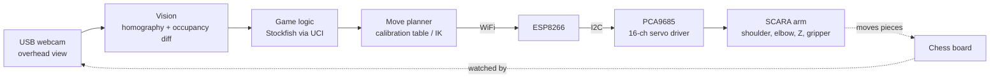
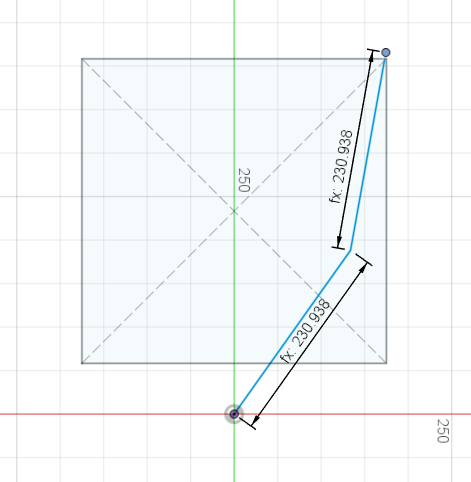
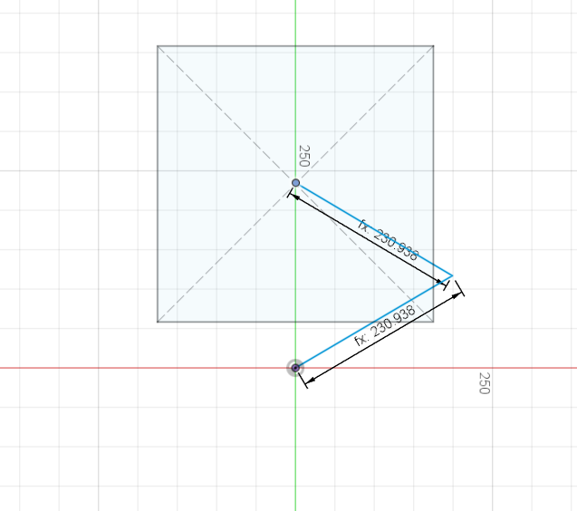
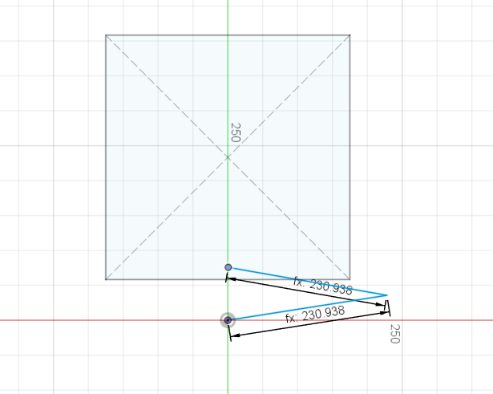

# Chess Robot Arm


A desk-sized SCARA robot arm that plays physical chess against a person. An overhead camera watches the board, Stockfish chooses a reply, and the arm picks up and moves the piece. The arm is driven by an ESP8266 and a 16-channel PWM servo driver, with a single power cable running to it.

> **Status: design phase.** The arm geometry is worked out and the CAD layout is parametric. Parts are being selected and the mechanical design is under way. Nothing has been built or flashed yet. See [Project status](#project-status).

## Goals

- Play a full game against a person on a real 350 mm board with standard Staunton pieces
- Reach every square, including the squares closest to the arm's own base
- Run only a power cable to the arm; send commands over WiFi
- Stay documented and reproducible: parametric CAD, a bill of materials, and written design rationale
- Serve as a reusable platform that could later be adapted into a desk-organising arm

## How it works (planned)



1. **Vision.** A fixed overhead webcam is calibrated to the board with a homography. After each human move, per-square occupancy is compared with the previous state: the move is the square that emptied and the one that filled. No piece recognition is needed. Castling, en passant and promotion are handled as special cases.
2. **Game logic.** [Stockfish](https://stockfishchess.org/) runs on the PC over the UCI protocol and returns the robot's reply.
3. **Motion.** Every square, the capture area and a home position are calibrated once as servo angles. Moves run as interpolated sequences: hover, lower, grip, lift, travel, lower, release, lift, home.
4. **Actuation.** The ESP8266 receives commands over WiFi and drives the PCA9685 servo driver over I2C.

## Design decisions

| Decision | Choice | Why |
|---|---|---|
| Arm type | SCARA: two vertical-axis rotary joints plus a Z axis | Gravity does not load the planar joints, a chess board is a plane, and two-link inverse kinematics has a closed-form solution. Compact enough to sit beside a monitor. A gantry was rejected as bulky; an articulated arm because its shoulder carries the full arm weight. |
| End effector | Parallel gripper, gripping the neck of standard Staunton pieces | Works with a real set. A magnet was rejected because standard piece tops are not uniform or flat. |
| Servo driver | Adafruit PCA9685 Featherwing | Generates 16 channels of PWM in hardware, so the microcontroller is not tied up with timing. An FPGA would be overkill for four servos. |
| Joint bearings | 3 inch square lazy-susan bearings at shoulder and elbow | Hobby servo shafts should not carry bending loads. The bearing carries the weight and the servo only rotates it. |
| Power | One 6 V supply for the servos, a buck converter for the logic rail | Isolates the logic supply from servo current spikes. |
| Comms | WiFi from PC to ESP8266 | Only a power cable reaches the arm. |
| Vision | Occupancy diff, not piece classification | Far simpler and more robust. |
| CAD | Parametric Fusion 360, every dimension derived from `board_size` | A different board only means changing one number. |

The reasoning and numbers behind each choice are in [docs/design-notes.md](docs/design-notes.md).

## Key numbers (design targets)

| Parameter | Value |
|---|---|
| Board | 350 mm, 43.75 mm squares |
| Base setback from board edge | 58.3 mm |
| Link lengths (L1 = L2) | 230.9 mm |
| Farthest square from shoulder | 415.7 mm (90% of full extension) |
| Nearest square from shoulder | about 80 mm |
| Shoulder travel needed | about 4° to 130° |
| Elbow bend needed | about 52° (far corner) to 160° (nearest squares) |
| Carry lift | about 80 mm, to clear a 76 mm king |

These come from the layout sketch and are estimates until the arm is built and measured.

## Reach verification

The arm skeleton was drawn in CAD with both link lengths locked and dragged to the extremes of the board.

| Far corner | Board centre | Nearest squares |
|---|---|---|
|  |  |  |

## Project status

| Area | Status |
|---|---|
| Concept and scope | Done |
| Servo selection | Done |
| Arm geometry and reach analysis | Done |
| Parametric CAD layout | Done |
| Shoulder pedestal and bearing mount | In progress |
| Links, elbow and Z mechanism | Not started |
| Gripper | Not started |
| Electronics and wiring | Not started |
| Firmware | Not started |
| Vision | Not started |
| Integration and testing | Not started |

## Roadmap

- [x] Choose project and scope
- [x] Select servos and bearings
- [x] Work out link lengths and reach for a 350 mm board
- [ ] Model the shoulder pedestal and bearing mount
- [ ] Model links, elbow joint, Z mechanism and gripper
- [ ] Order parts, measure real servo and bearing dimensions, update the CAD parameters
- [ ] Print and assemble the arm
- [ ] Bench-test each joint through its range
- [ ] Calibrate all 64 squares, the capture area and the home position
- [ ] Pick-and-place test without vision
- [ ] Camera calibration and occupancy-based move detection
- [ ] Stockfish integration
- [ ] Full game loop, including castling, en passant, promotion and captures
- [ ] Stretch: gear reduction at the shoulder for finer resolution
- [ ] Stretch: adapt the platform into a desk-organising arm

## Repository layout

```
chess-robot-arm/
├── docs/               Design notes, bill of materials, build log, images
├── hardware/           CAD overview and exported models
│   └── cad/
├── firmware/           ESP8266 firmware (not started)
│   └── src/
├── software/           Vision, game logic and move planner (not started)
├── CHANGELOG.md        Automatic log of CAD exports, written by the Fusion-to-GitHub add-in
├── LICENSE
└── README.md
```

## Documentation

- [Arm design plan](docs/arm-design-plan.md): the staged plan for the mechanical design, with the check that ends each stage
- [Design notes](docs/design-notes.md): layout parameters, reach maths, loads, bearings, vertical stack, open questions
- [Bill of materials](docs/bill-of-materials.md): parts, sources and status
- [Build log](docs/build-log.md): what was done and decided, in order
- [Changelog](docs/CHANGELOG.md): notable project changes, written by hand
- [Hardware](hardware/README.md), [Firmware](firmware/README.md), [Software](software/README.md)

## License

Released under the [MIT License](LICENSE). This covers the code, CAD files and documentation.

## Acknowledgements

- [Stockfish](https://stockfishchess.org/) for the chess engine
- [OpenCV](https://opencv.org/) for the planned vision pipeline
- [Adafruit](https://www.adafruit.com/) for the PCA9685 servo driver hardware and libraries
